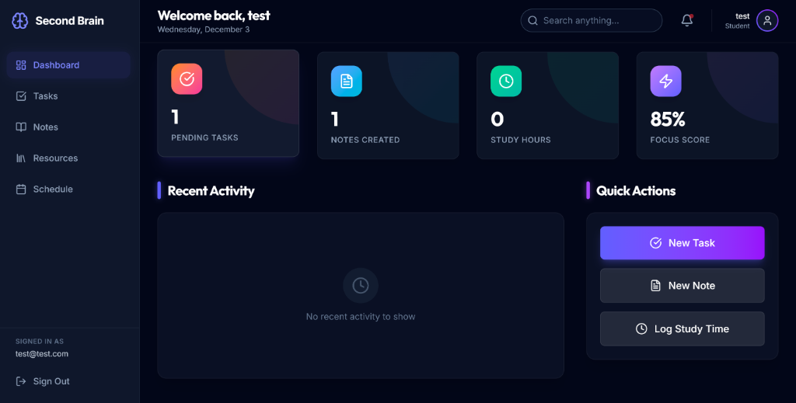

# 🧠 SmartBrain - Your Second Brain for Academic Success

[](https://github.com/roei10101/SmartBrain/actions/workflows/ci.yml)
[](LICENSE)



 **SmartBrain** is a comprehensive student management system designed to organize your academic life. From tracking assignments and grades to managing your study schedule and resources, SmartBrain acts as your digital "Second Brain," helping you stay focused and achieve your goals.

---

## ✨ Key Features

SmartBrain offers a suite of tools tailored for students:

*   **📊 Dashboard**: Get a bird's-eye view of your academic status with real-time statistics, upcoming deadlines, and active tasks.
*   **✅ Task Management**: Create, prioritize, and track tasks. Never miss an assignment again.
*   **📅 Study Schedule**: visual calendar to manage your classes, exams, and study sessions.
*   **🎓 Grade Tracking**: Keep a record of your grades for every course and monitor your GPA.
*   **📚 Resource Hub**: Centralize all your study materials, links, and documents in one place.
*   **📝 Quick Notes**: Capture ideas and lecture notes instantly.

---

## 🛠️ Built With

This project leverages a modern, high-performance tech stack:

### Frontend
*    **React 19** - The library for web and native user interfaces.
*    **TailwindCSS 4** - A utility-first CSS framework for rapid UI development.
*    **Vite** - Next Generation Frontend Tooling.
*   **Lucide React** - Beautiful & consistent icons.

### Backend
*    **FastAPI** - High performance, easy to learn, fast to code, ready for production.
*    **Python 3.10+** - The programming language that lets you work quickly.
*    **PostgreSQL** - The World's Most Advanced Open Source Relational Database.
*   **SQLAlchemy** - The Python SQL Toolkit and Object Relational Mapper.
*   **Pydantic** - Data validation using Python type hints.

### DevOps
*    **Docker** - Containerize your applications.
*   **Docker Compose** - Define and run multi-container Docker applications.
*   **Kubernetes** - Kustomize manifests with probes, autoscaling and network policies.
*   **GitHub Actions** - Lint, tests, config validation and image builds on every push.
*   **Prometheus & Grafana** - Metrics, alert rules and dashboards.

---

## 🚀 Getting Started

### Prerequisites

*   **Git** and **Docker** (with Docker Compose v2)
*   *OR* for a manual setup: **Node.js 20+**, **Python 3.10+** and **PostgreSQL 15**

### Option 1: Docker (recommended 🐳)

```bash
git clone https://github.com/roei10101/SmartBrain.git
cd SmartBrain

# 1. Create your local configuration - no secret is stored in the repository
cp .env.example .env
#    then set POSTGRES_PASSWORD and SECRET_KEY, e.g. with: openssl rand -hex 32

# 2. Build and start everything
docker compose up --build
```

| Service | URL |
| :--- | :--- |
| Frontend | http://localhost:5173 |
| Backend API | http://localhost:5000 |
| API docs (Swagger) | http://localhost:5000/docs |
| Health check | http://localhost:5000/health |
| Prometheus metrics | http://localhost:5000/metrics |

Compose refuses to start when a required secret is missing, so a forgotten `.env` fails loudly instead of falling back to a default password.

To seed the demo account: `docker compose exec backend python init_db.py`

For live reload during development:

```bash
docker compose -f docker-compose.yml -f docker-compose.dev.yml up --build
```

### Option 2: Manual setup 🛠️

```bash
# Backend
cd backend
python -m venv venv && source venv/bin/activate   # Windows: venv\Scripts\activate
pip install -r requirements-dev.txt
cp .env.example .env                               # set DATABASE_URL and SECRET_KEY
python create_db.py                                # creates the database if needed
uvicorn main:app --reload --port 5000

# Frontend (second terminal)
cd frontend
npm install
VITE_API_URL=http://localhost:5000 npm run dev     # http://localhost:5173
```

### Configuration

| Variable | Used by | Description |
| :--- | :--- | :--- |
| `POSTGRES_USER` / `POSTGRES_PASSWORD` / `POSTGRES_DB` | db, backend | Database credentials (Docker setup) |
| `DATABASE_URL` | backend | Full connection string (manual setup) |
| `SECRET_KEY` | backend | JWT signing key - **required**, the API will not start without it |
| `ALGORITHM`, `ACCESS_TOKEN_EXPIRE_MINUTES` | backend | JWT settings (default `HS256`, `30`) |
| `CORS_ORIGINS` | backend | Comma separated list of allowed origins |
| `VITE_API_URL` | frontend (build time) | URL of the API as seen from the browser |

---

## 🧪 Tests & Code Quality

```bash
cd backend
ruff check .      # lint
pytest            # API tests, run against an isolated SQLite database

cd frontend
npm run lint
npm run build
```

The backend suite covers authentication (hashing, login, expired and forged tokens), CRUD flows for every resource, and **tenant isolation** - one user can never read or modify another user's data.

Every push and pull request runs the same checks in [GitHub Actions](.github/workflows/ci.yml): lint and tests, a frontend build, validation of the Compose and Kubernetes configuration, and a Docker build of both images. On `main` the images are pushed to GitHub Container Registry tagged with the commit SHA.

---

## ☸️ Deployment

### Kubernetes

Manifests live in [`deploy/k8s`](deploy/k8s) and are applied with Kustomize:

```bash
kubectl create namespace smartbrain
kubectl -n smartbrain create secret generic smartbrain-secrets \
  --from-literal=POSTGRES_PASSWORD="$(openssl rand -hex 24)" \
  --from-literal=SECRET_KEY="$(openssl rand -hex 32)"

kubectl apply -k deploy/k8s
```

What you get:

*   **Backend** - 2 replicas, zero-downtime rolling updates, startup / readiness / liveness probes on `/health`, CPU-based autoscaling (2-5 pods) and a PodDisruptionBudget
*   **Frontend** - static build served by unprivileged nginx
*   **PostgreSQL** - StatefulSet with a persistent volume, reachable only from the backend (NetworkPolicy)
*   **Hardening** - non-root containers, read-only root filesystem, all capabilities dropped, secrets injected from a `Secret` that is never committed
*   **Ingress** - edit the hosts in `deploy/k8s/ingress.yaml` and `CORS_ORIGINS` in `configmap.yaml` for your domain

### Monitoring

The API exposes Prometheus metrics (request rate, latency histograms, status codes) at `/metrics`. A ready-made stack ships with the Compose file:

```bash
docker compose --profile monitoring up
```

*   Prometheus: http://localhost:9090 - scrape config and alert rules (backend down, 5xx rate above 5%, p95 latency above 1s) in [`deploy/monitoring`](deploy/monitoring)
*   Grafana: http://localhost:3001 - Prometheus is pre-provisioned as a data source

In Kubernetes the backend pods carry the standard `prometheus.io/scrape` annotations.

---

## 📂 Project Structure

```
SmartBrain/
├── backend/                 # FastAPI application
│   ├── main.py              # Routes, CORS, health and metrics endpoints
│   ├── models.py            # SQLAlchemy models
│   ├── schemas.py           # Pydantic schemas
│   ├── crud.py              # Database operations (always scoped to the current user)
│   ├── auth.py              # Password hashing and JWT handling
│   ├── tests/               # pytest suite
│   └── Dockerfile
├── frontend/                # React + Vite application
│   ├── src/
│   │   ├── components/      # Reusable UI components
│   │   ├── pages/           # Application pages
│   │   └── services/        # API client
│   ├── nginx.conf
│   └── Dockerfile
├── deploy/
│   ├── k8s/                 # Kubernetes manifests (Kustomize)
│   └── monitoring/          # Prometheus + Grafana configuration
├── .github/workflows/ci.yml # CI/CD pipeline
├── docker-compose.yml       # Local / single-host orchestration
└── .env.example             # Configuration template
```

---

## 🤝 Contributing

Contributions are what make the open source community such an amazing place to learn, inspire, and create. Any contributions you make are **greatly appreciated**.

1.  Fork the Project
2.  Create your Feature Branch (`git checkout -b feature/AmazingFeature`)
3.  Commit your Changes (`git commit -m 'Add some AmazingFeature'`)
4.  Push to the Branch (`git push origin feature/AmazingFeature`)
5.  Open a Pull Request

---

## 🌐 Live Demo

**https://smartbrain.roeiduenyas.me/**

A shared demo account is available: `test@test.com` / `test`.

## 📄 License

Distributed under the MIT License. See `LICENSE` for more information.

---

